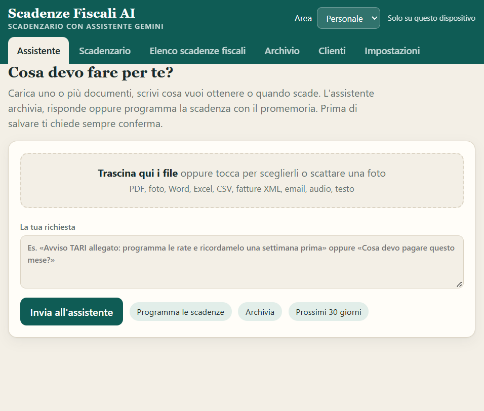

# Scadenze Fiscali AI

Scadenzario fiscale con assistente Gemini, per uso personale.

## Schermate dell'app

Le immagini seguenti mostrano schermate reali dell'app.

| Assistente | Scadenzario | Elenco scadenze fiscali |
|:---:|:---:|:---:|
|  |  |  |

## Cosa fa

- **Assistente** – carichi PDF, foto, Word, Excel, email, audio o scrivi testo libero; Gemini propone di archiviare, rispondere o programmare la scadenza con promemoria. Nulla viene salvato senza conferma.
- **Scadenzario** – elenco e vista mese, stati (da fare, scaduta, fatta), esportazione calendario.
- **Elenco scadenze fiscali** – regole ricorrenti per privati, forfettari, P.IVA ordinarie e società, datori di lavoro, rottamazione, con la prossima data calcolata.
- **Clienti** – ogni cliente ha scadenzario e archivio propri.
